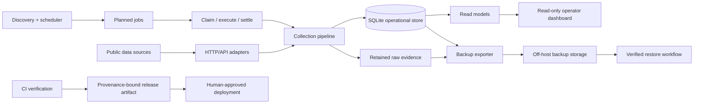

# Race Data Collection & Operations Platform

A Rust reference project and engineering case study for reliable single-node data systems. The public code demonstrates SQLite job coordination, deterministic event-relative scheduling, and backup integrity verification using synthetic data.

> **Portfolio note**  
> The reference implementations are independently written, reusable examples under the [MIT license](LICENSE). The production collector, credentials, source-specific request contracts, operational endpoints, and collected datasets remain private.

## Run the public examples

Requires Rust 1.94 or newer and a C compiler for the bundled SQLite build. Run these commands from the repository root; no credentials, network data source, or production database is needed.

```bash
cargo run --locked --example sqlite_job_queue
cargo run --locked --example event_scheduler
cargo run --locked --example backup_verifier
```

The queue and scheduler demos use in-memory databases and fixed synthetic timestamps. The backup demo reads the included [synthetic fixture](fixtures/synthetic-backup/events.csv) against an expected size and SHA-256 recorded in the example.

| Public component | Demonstrated behavior | Runnable example |
| --- | --- | --- |
| [SQLite job queue](src/job_queue.rs) | Stable keys, atomic claims, expiring leases, stale-claim rejection, idempotent settlement | [sqlite_job_queue.rs](examples/sqlite_job_queue.rs) |
| [Event scheduler](src/scheduling.rs) | Signed offsets, deterministic identity/order, duplicate suppression, checked timestamp arithmetic | [event_scheduler.rs](examples/event_scheduler.rs) |
| [Backup verifier](src/backup.rs) | Streaming size/SHA-256 checks, missing-file detection, path containment | [backup_verifier.rs](examples/backup_verifier.rs) |

These examples are the implemented public scope. The architecture documents below describe the broader private system; the repository does not ship a collector, dashboard, migration engine, remote backup service, or production release pipeline.

## Reference contracts and limits

- **Job coordination:** a single SQLite `UPDATE ... RETURNING` selects and claims work atomically. Reclaiming an expired lease increments a generation, so an earlier claim cannot settle the newer attempt. Retrying settlement with the successful claim returns success. Times are caller-supplied Unix seconds and require a consistent clock. Worker side effects still need idempotency; leases do not guarantee exactly-once execution.
- **Scheduling:** job keys combine event identity and offset. Enqueuing an existing key preserves its original time and state. Changing an event time requires a separate rescheduling policy; this example does not silently move existing work.
- **Backup verification:** a nonempty, trusted manifest must be recorded before transfer and kept separately from the files being verified. Verification checks only listed regular files in an offline, operator-controlled directory. It rejects traversal, absolute paths, and symlinks that escape the root. It does not authenticate the manifest, reject unlisted files, extract archives, validate SQLite contents, or prove recovery readiness. Concurrent hostile filesystem changes require stronger file-opening controls.

## Tests and contributions

The [integration tests](tests/reference_patterns.rs) exercise separate SQLite connections claiming concurrently, lease expiry, durable settlement, scheduler/queue integration, invalid timestamps, checksum tampering, missing files, and unsafe backup paths.

```bash
cargo fmt --all -- --check
cargo clippy --workspace --all-targets --locked -- -D warnings
cargo test --workspace --all-targets --locked -- --test-threads=2
```

[CI](.github/workflows/ci.yml) runs these checks and all three examples on pushes and pull requests. Contributions should include a focused regression test and use synthetic fixtures. Keep source-specific adapters, infrastructure details, credentials, and collected data outside this repository; see the [publication boundary](docs/security-and-publication.md).

## Why I built it

Long-running data collectors are easy to prototype and surprisingly hard to operate safely. The engineering challenge is not merely sending HTTP requests; it is deciding what should run and when, avoiding duplicate work, preserving enough evidence to explain past results, evolving the database without corrupting state, recovering from failures, and deploying changes without losing provenance.

I used the private collector to work through those problems as a systems/backend engineering exercise. These public examples make three of the patterns inspectable and executable without requiring that collector.

## What the private platform does

The broader private system described in the case-study documents:

- discovers upcoming domain events and derives time-based collection jobs;
- collects multiple categories of publicly available data through HTTP/API adapters;
- keeps retained raw evidence alongside normalized SQLite records;
- uses explicit job claims and bounded writer transactions to coordinate work;
- records append-oriented observations so later normalization changes do not erase historical evidence;
- exposes a read-only operator dashboard;
- creates managed off-host backups and verifies restore paths;
- applies additive SQLite migrations and explicit maintenance procedures;
- produces provenance-bound release artifacts through CI.

## Engineering focus

| Area | What I focused on |
| --- | --- |
| Language/runtime | Rust, async I/O, explicit error handling, bounded operational commands |
| Persistence | SQLite, WAL, transactions, additive migrations, append-oriented evidence |
| Scheduling | Event-relative windows, deterministic job derivation, claim lifecycle, retries |
| Reliability | Idempotency, retained raw payloads, reconciliation, health reporting, recovery paths |
| Backup & restore | Export manifests, checksums/fingerprints, off-host upload, restore verification |
| Operations | Long-running daemon, one-shot commands, maintenance windows, read-only dashboard |
| Security | Loopback-bound dashboard origin with an external identity-aware access layer |
| Delivery | Formatting/lint/test gates, locked dependencies, immutable versioned artifacts, provenance metadata |

## Architecture at a glance



The key design choice is that **collection evidence, operational state, and read models are separate concerns**. A failed or revised normalization step should not require pretending the original observation never happened.

## Selected design principles

1. **Evidence before convenience.** Retain enough source evidence and lineage to explain how a normalized record was produced.
2. **Append history, project current state.** Historical observations are not overwritten merely to simplify reads; current views are derived separately.
3. **Make writer ownership explicit.** Jobs and maintenance operations use explicit claims/transactions instead of relying on timing assumptions.
4. **Recovery is a product feature.** A backup is not considered useful unless the restore path is exercised and verifiable.
5. **Prefer additive change.** Schema evolution is designed to minimize destructive migration and make rollback boundaries explicit.
6. **Release provenance matters.** A version number is insufficient; artifacts should be traceable to exact source and dependency state.

## Repository guide

- [`docs/architecture.md`](docs/architecture.md) — component boundaries and data flow
- [`docs/data-model.md`](docs/data-model.md) — evidence-oriented persistence model
- [`docs/scheduling.md`](docs/scheduling.md) — event-relative scheduling and job claims
- [`docs/reliability.md`](docs/reliability.md) — failure model, idempotency, reconciliation and observability
- [`docs/backup-recovery.md`](docs/backup-recovery.md) — backup/restore design and recovery invariants
- [`docs/release-process.md`](docs/release-process.md) — CI verification, artifact provenance and deployment boundaries
- [`docs/security-and-publication.md`](docs/security-and-publication.md) — what is intentionally excluded from this public repository
- [`docs/adr/0001-evidence-first-storage.md`](docs/adr/0001-evidence-first-storage.md) — why raw evidence is retained
- [`docs/adr/0002-sqlite-for-single-node-operations.md`](docs/adr/0002-sqlite-for-single-node-operations.md) — why SQLite remains appropriate for this deployment model
- [`docs/adr/0003-private-source-public-case-study.md`](docs/adr/0003-private-source-public-case-study.md) — publication boundary

## What this repository intentionally does not prove

This case study is not a benchmark and does not claim hyperscale throughput, distributed consensus, high-frequency trading capability, prediction accuracy, or financial return. The production workload is a single-node operational system. The value of the project is the engineering discipline around correctness, traceability, recoverability, and safe operations.

## Status

The public reference code is an initial 0.1.0 implementation maintained alongside the architectural case study. It has no published throughput benchmarks or measured adoption claims. The underlying collector remains private and is used as a personal engineering project. The reference package is available from this repository and is not published to crates.io.

## License

The public code, synthetic fixtures, and documentation are available under the [MIT license](LICENSE). This license does not apply to private code or data outside this repository.
