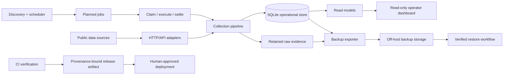

# Race Data Collection & Operations Platform

A private-source engineering case study for a Rust-based platform that collects publicly available horse-racing data, preserves source evidence, schedules time-sensitive collection work, and supports safe day-2 operations.

> **Portfolio note**  
> This repository documents architecture and engineering decisions only. The production source code, credentials, source-specific request contracts, operational endpoints, and collected datasets remain private.

## Why I built it

Long-running data collectors are easy to prototype and surprisingly hard to operate safely. The engineering challenge is not merely sending HTTP requests; it is deciding what should run and when, avoiding duplicate work, preserving enough evidence to explain past results, evolving the database without corrupting state, recovering from failures, and deploying changes without losing provenance.

I used this project to work through those problems as a systems/backend engineering exercise.

## What the platform does

At a high level, the system:

- discovers upcoming domain events and derives time-based collection jobs;
- collects multiple categories of publicly available data through HTTP/API adapters;
- keeps retained raw evidence alongside normalized SQLite records;
- uses explicit job claims and bounded writer transactions to coordinate work;
- records append-oriented observations so later normalization changes do not erase historical evidence;
- exposes a read-only operator dashboard;
- creates managed off-host backups and verifies restore paths;
- applies additive SQLite migrations and explicit maintenance procedures;
- produces provenance-bound release artifacts through CI.

## Engineering focus

| Area | What I focused on |
| --- | --- |
| Language/runtime | Rust, async I/O, explicit error handling, bounded operational commands |
| Persistence | SQLite, WAL, transactions, additive migrations, append-oriented evidence |
| Scheduling | Event-relative windows, deterministic job derivation, claim lifecycle, retries |
| Reliability | Idempotency, retained raw payloads, reconciliation, health reporting, recovery paths |
| Backup & restore | Export manifests, checksums/fingerprints, off-host upload, restore verification |
| Operations | Long-running daemon, one-shot commands, maintenance windows, read-only dashboard |
| Security | Loopback-bound dashboard origin with an external identity-aware access layer |
| Delivery | Formatting/lint/test gates, locked dependencies, immutable versioned artifacts, provenance metadata |

## Architecture at a glance

The key design choice is that **collection evidence, operational state, and read models are separate concerns**. A failed or revised normalization step should not require pretending the original observation never happened.

## Selected design principles

1. **Evidence before convenience.** Retain enough source evidence and lineage to explain how a normalized record was produced.
2. **Append history, project current state.** Historical observations are not overwritten merely to simplify reads; current views are derived separately.
3. **Make writer ownership explicit.** Jobs and maintenance operations use explicit claims/transactions instead of relying on timing assumptions.
4. **Recovery is a product feature.** A backup is not considered useful unless the restore path is exercised and verifiable.
5. **Prefer additive change.** Schema evolution is designed to minimize destructive migration and make rollback boundaries explicit.
6. **Release provenance matters.** A version number is insufficient; artifacts should be traceable to exact source and dependency state.

## Repository guide

- [`docs/architecture.md`](docs/architecture.md) — component boundaries and data flow
- [`docs/data-model.md`](docs/data-model.md) — evidence-oriented persistence model
- [`docs/scheduling.md`](docs/scheduling.md) — event-relative scheduling and job claims
- [`docs/reliability.md`](docs/reliability.md) — failure model, idempotency, reconciliation and observability
- [`docs/backup-recovery.md`](docs/backup-recovery.md) — backup/restore design and recovery invariants
- [`docs/release-process.md`](docs/release-process.md) — CI verification, artifact provenance and deployment boundaries
- [`docs/security-and-publication.md`](docs/security-and-publication.md) — what is intentionally excluded from this public repository
- [`docs/adr/0001-evidence-first-storage.md`](docs/adr/0001-evidence-first-storage.md) — why raw evidence is retained
- [`docs/adr/0002-sqlite-for-single-node-operations.md`](docs/adr/0002-sqlite-for-single-node-operations.md) — why SQLite remains appropriate for this deployment model
- [`docs/adr/0003-private-source-public-case-study.md`](docs/adr/0003-private-source-public-case-study.md) — publication boundary

## What this repository intentionally does not prove

This case study is not a benchmark and does not claim hyperscale throughput, distributed consensus, high-frequency trading capability, prediction accuracy, or financial return. The production workload is a single-node operational system. The value of the project is the engineering discipline around correctness, traceability, recoverability, and safe operations.

## Status

The underlying implementation is private and actively used as a personal engineering project. This public repository is a curated architectural record intended for code-review and recruiting conversations.
