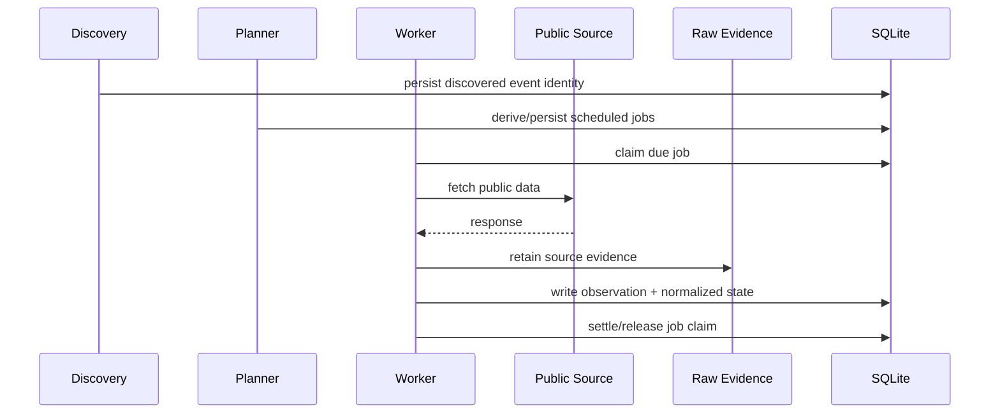

# Architecture

## 1. System boundary

The platform is a single-node Rust service with a SQLite operational store, retained raw payload storage, a read-only dashboard, and an off-host backup path.

The design deliberately avoids presenting a distributed architecture where one is not required. The workload benefits more from deterministic state transitions and recoverability than from introducing multiple networked stateful services.

## 2. Major components

### Discovery

Discovery converts publicly observable event information into stable domain identities. It is responsible for identifying future work, not for performing every downstream collection immediately.

### Planner and scheduler

The planner derives collection jobs from event time and policy. Jobs are persisted so that scheduling decisions survive process restarts.

Typical policies use event-relative windows such as "several days before", "one day before", or "shortly before" the event. Exact production windows are intentionally omitted from this public case study.

### Job claim lifecycle

Workers do not assume that a due job is theirs simply because they observed it first. A job moves through an explicit claim lifecycle with bounded lease/expiry semantics. This allows stale work to be recovered and makes duplicate execution easier to reason about.

### Collection adapters

Source-specific HTTP/API details live behind adapters. The rest of the pipeline deals with typed observations rather than embedding endpoint behavior throughout the application.

### Evidence store

Successful fetches can preserve retained raw payloads and lineage metadata. Normalization is therefore reproducible from evidence when practical, and parsing bugs do not automatically destroy the original observation.

### SQLite operational store

SQLite holds planning state, normalized facts, observations, lineage, backup metadata, and operational read models. WAL and explicit transaction boundaries support the single-node daemon/dashboard/maintenance workload.

### Read models and dashboard

The operator dashboard is read-only. Operational pages consume bounded read models instead of becoming another writer. The origin service is designed to stay private/loopback-bound and sit behind an external access layer when remotely published.

### Backup and recovery

Backup is treated as a workflow rather than a file copy. Export units include metadata needed to identify and verify contents. Restore paths include validation before recovered state is accepted.

### Release pipeline

CI verifies formatting, linting and tests with locked dependencies. Release candidates include provenance metadata binding the artifact to its source/dependency/build context. Deployment remains an explicit human-approved operation.

## 3. Data flow



## 4. Authority boundaries

A useful operational system needs explicit answers to "what is authoritative?" The implementation separates:

- **raw evidence** — what was observed;
- **normalized facts** — the application's interpretation of that evidence;
- **current projections** — the latest state convenient for consumers;
- **planner state** — what work should happen;
- **operator state** — health, backup and maintenance metadata.

Conflating these concerns would make corrections and recovery substantially harder.

## 5. Deployment shape

```text
Internet
   |
Identity-aware access layer
   |
Encrypted tunnel / private ingress
   |
loopback-only dashboard ----+
                            |
                       Rust process
                            |
                 +----------+----------+
                 |                     |
            SQLite (WAL)          retained raw
                 |                     |
                 +----------+----------+
                            |
                     backup exporter
                            |
                     off-host storage
```

No production hostname, IP address, access-policy identifier, source endpoint, or credential is included in this repository.
