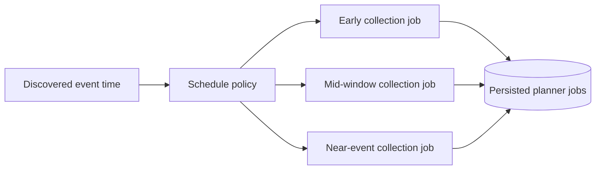

# Scheduling and Work Coordination

## 1. Problem

The collector is event-driven but not purely reactive. Some information becomes useful days before an event, some changes more rapidly nearer the event, and post-event material appears later. A fixed "poll everything every N minutes" loop would waste requests and make coverage harder to reason about.

## 2. Event-relative scheduling

The scheduler derives jobs from a known event time and a policy of relative offsets.



Persisting derived jobs is important: after a restart, the process can inspect what was planned, what was attempted, and what remains due instead of reconstructing all state from memory.

## 3. Deterministic job identity

A scheduled job is based on stable dimensions such as:

- subject/event identity;
- source family or adapter;
- planned collection window;
- optional enrichment phase.

Stable identity helps prevent the planner from creating semantically duplicate work every time discovery runs.

## 4. Claim lifecycle

When a worker selects due work, it acquires an explicit claim/lease. Conceptually:

```text
pending -> claimed -> settled
             |
             +-> expired/stale -> reclaimable
```

The claim ledger records worker/service-instance ownership and expiry information. This is useful even on a single host because process crashes, restarts, manual commands and daemon work can otherwise create ambiguous ownership.

## 5. Why claims instead of a boolean flag

A single `is_running=true` flag cannot answer:

- who owns the work;
- when ownership began;
- whether the owner is still alive;
- when another worker may safely retry;
- whether a crash left stale state.

Lease-style claims make those questions explicit and testable.

## 6. Idempotency and settlement

A job attempt should be safe to reconcile if:

- the HTTP request succeeds but the process dies before settlement;
- evidence is written but normalized output is incomplete;
- the same source content is observed again;
- a stale claim is recovered.

The platform therefore separates **claim**, **collection**, **evidence/normalization write**, and **settlement** rather than treating them as an indivisible black box.

## 7. Operational modes

The private implementation supports both:

- a long-running daemon for routine discovery/drain cycles;
- bounded one-shot commands for manual verification, repair and maintenance.

This dual interface is intentional. Operational recovery is easier when important actions can be invoked deterministically without booting the entire daemon lifecycle.
